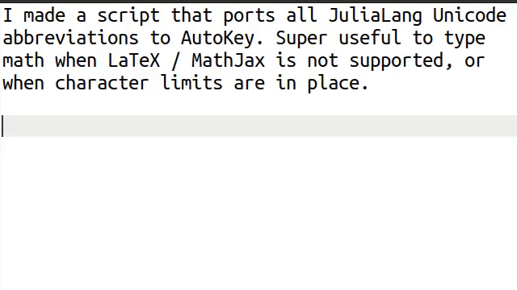

# AutoKey Unicode characters

[Contributing](CONTRIBUTING.md) | [License](LICENSE) | [Changelog](CHANGELOG.md)

[Usage](#usage) | [Requirements](#requirements) | [Installation](#installation) | [Features](#features) | [Choosing a font](#choosing-a-font) | [Known Issues](#known-issues--limitations) | [References](#references)



## Usage

This script adds all the Unicode character abbreviations supported
by [Julia](https://docs.julialang.org/en/v1/manual/unicode-input/#Unicode-Input) to AutoKey. However, instead of
`[TAB]`, they are triggered on `[SPACE]`. If you do not want to perform the replacement, simply hit `[BACKSPACE]`
afterwards.

## Requirements

- Python ≥3.12.3.
- [AutoKey](https://github.com/autokey/autokey) ≥0.96.0, running on X11. Wayland is unsupported.
- Julia ≥1.11 (optional), only needed to regenerate the Julia Unicode tables. Installing the bundled tables does not
  require Julia.

The bundled Unicode reference data uses **Unicode 18.0.0**. Available abbreviations
come from the [Julia and custom icon collections](data/icons/README.md); displaying a
character requires a [font with the corresponding glyph](#choosing-a-font).

## Installation

1. Install [AutoKey](https://github.com/autokey/autokey).
2. From the repository root, run:

   ```bash
   ./src/install_autokey.py
   ```

   Alternatively, run `just install` if you have [just](https://github.com/casey/just) installed.

3. Restart AutoKey.

The installer asks which special characters to include and confirms before replacing
the entire extension directory; keep personal phrases and scripts outside that directory.

### Installation details

See the [technical installation guide](docs/installation.md) for options, build behavior, and updating the bundled data.

## Choosing a font

Use [Programming Fonts](https://www.programmingfonts.org/) to compare editor
fonts in the browser. Paste in the [Unicode font demo](docs/demo.md), then
open the sample file as plain text in your own editor to check glyph shapes,
combining marks, and character widths. The [font guide](docs/fonts.md) explains
what to inspect and records previous comparison results.

For mathematical code and notes, try these monospaced fonts:

- [JuliaMono](https://juliamono.netlify.app/): our first recommendation for
  mathematical code and notes, with broad coverage of Greek letters,
  mathematical operators, and styled mathematical alphabets.
- [PragmataPro Mono](https://fsd.it/shop/fonts/pragmatapro/): a commercial
  alternative with extensive mathematical symbol and
  [styled alphabet coverage](https://fsd.it/pragmatapro/All_chars.txt).
  Choose the full Mono family for fixed-width text; the Essential edition has
  reduced character coverage.
- [Iosevka](https://github.com/be5invis/Iosevka): a customizable alternative
  with Greek letters and many mathematical symbols. Consult its
  [character specimen](https://typeof.net/Iosevka/specimen) and check the styled
  mathematical alphabets you need in your installed version.

For styled letters such as `𝐀`, `𝑥`, `𝔸`, and `𝛼` (Mathematical Alphanumeric
Symbols, U+1D400–U+1D7FF), prefer JuliaMono or the full PragmataPro Mono.
Coverage depends on the font version and style, and applications can silently
substitute fallback fonts. See [checking installed font coverage](docs/fonts.md#checking-installed-font-coverage)
for Linux commands to check whether a font contains a particular character.

## Features

For overview see [Supported Alphabets](#supported-alphabets)

### Advantages of Unicode

1. Work even when MathJax / LaTeX is not available (e.g. E-mails, chat clients, etc.)
2. Is character efficient (e.g. when writing comments on <https://math.stackexchange.com>)
3. Increases readability of source code.
4. Copy-paste persistent.

### Compatibility with MathJax & LaTeX

1. MathJax supports Unicode characters: `$\sin(\theta)$` and `$\sin(θ)$` should look exactly the same.
2. [LuaLaTeX](http://www.luatex.org/) has Unicode compatibility, at least in math-mode when using
   the [unicode-math](https://github.com/wspr/unicode-math) package.
3. For PDFLaTeX support, see the separate [latex-unicode](https://github.com/randolf-scholz/latex-unicode) project.

### Supported Alphabets

To create single characters of the given alphabet, simply type `\<modifier><char><space>`.

- For blackboard bold R, `ℝ`, type `\bbR␣`.
- For a circled one, `①`, type `\o1␣`.
- For a bold italic capital gamma, `𝜞`, type `\biGamma␣`.
- For the sub and superscripts, `Xᵢ²`, type `X\_i␣\^2␣`.
- For the Roman numeral `Ⅷ` (this is a single UTF-8 glyph, and not `V`+`I`+`I`+`I`), type `\RM8␣`.

#### Serif Font

| family | `\bf<>` | `\it<>` | `\bi<>` |
|--------|---------|---------|---------|
| Latin  | 𝐚𝐛𝐜𝐀𝐁𝐂  | 𝑎𝑏𝑐𝐴𝐵𝐶  | 𝒂𝒃𝒄𝑨𝑩𝑪  |
| Greek  | 𝛂𝛃𝛄𝚨𝚩𝚪  | 𝛼𝛽𝛾𝛢𝛣𝛤  | 𝜶𝜷𝜸𝜜𝜝𝜞  |
| Digits | 𝟎𝟏𝟐     | —       | —       |

#### Sans Serif Font

| family      | `\sans<>` | `\bsans<>` | `\isans<>` | `\bisans<>` |
|-------------|-----------|------------|------------|-------------|
| Latin upper | 𝖠𝖡𝖢       | 𝗔𝗕𝗖        | 𝘈𝘉𝘊        | 𝘼𝘽𝘾         |
| Latin lower | 𝖺𝖻𝖼       | 𝗮𝗯𝗰        | 𝘢𝘣𝘤        | 𝙖𝙗𝙘         |
| Greek upper | —         | 𝝖𝝗𝝘        | —          | 𝞐𝞑𝞒         |
| Greek lower | —         | 𝝰𝝱𝝲        | —          | 𝞪𝞫𝞬         |
| Digits      | 𝟢𝟣𝟤       | 𝟬𝟭𝟮        | —          | —           |

#### Specialty Font

| family      | `\tt<>` | `\bb<>` | `\frak<>` | `\bfrak<>` | `\scr<>` | `\bscr<>` |
|-------------|---------|---------|-----------|------------|----------|-----------|
| Latin upper | 𝙰𝙱𝙲     | 𝔸𝔹ℂ     | 𝔄𝔅ℭ       | 𝕬𝕭𝕮        | 𝒜ℬ𝒞      | 𝓐𝓑𝓒       |
| Latin lower | 𝚊𝚋𝚌     | 𝕒𝕓𝕔     | 𝔞𝔟𝔠       | 𝖆𝖇𝖈        | 𝒶𝒷𝒸      | 𝓪𝓫𝓬       |
| Digits      | 𝟶𝟷𝟸     | 𝟘𝟙𝟚     | —         | —          | —        | —         |

#### Numerals

| family | `\<>.` | `\rm<>` | `\RM<>` |
|--------|--------|---------|---------|
| 0      | —      | —       | —       |
| 1      | ⒈      | ⅰ       | Ⅰ       |
| 2      | ⒉      | ⅱ       | Ⅱ       |
| 3      | ⒊      | ⅲ       | Ⅲ       |

#### Other Families

| family      | `\^<>` | `\_<>` | `\o<>` | `\(<>)` | `\sc<>` | `\fw<>` |
|-------------|--------|--------|--------|---------|---------|---------|
| Latin upper | ᴵᴶᴷ    | —      | ⒶⒷⒸ    | —       | ᴀʙᴄᴅ    | ＡＢＣ  |
| Latin lower | ⁱʲᵏ    | ᵢⱼₖ    | ⓐⓑⓒ    | ⒜⒝⒞     | —       | ａｂｃ  |
| Greek upper | —      | —      | —      | —       | —       | —       |
| Greek lower | ᵝᵞᵠ    | ᵦᵧᵩ    | —      | —       | —       | —       |
| Digits      | ⁰¹²    | ₀₁₂    | ⓪①②    | ⑴⑵⑶     | —       | ０１２  |

Note: Generally here not all characters are available:

- Small capital letters is missing `\scX`.
- Sub- and superscripts is missing quite a few letters,
  see: <https://en.wikipedia.org/wiki/Unicode_subscripts_and_superscripts>.

## Known Issues & Limitations

- When using the `Markdown All in One` extension for VS Code, make sure to disable the `backspace` hotkey, otherwise
  `AutoKey` will not be able to insert the Unicode characters.
- So far was only tested with Ubuntu 20.04 LTS and `Autokey` 0.95.10
- Seems to behave weird with **Gnome Terminal**, no idea what's going on.
- Can show strange behavior with **VS Code**.
  - Seems fixable by deleting all `[shift]+[insert]` hotkeys combinations. (`File > Preferences > Keyboard Shortcuts`)
  - Our macros here insert symbols with `[shift]+[insert]`
    and [VS Code seems to mess with that](https://github.com/microsoft/vscode/issues/90637)
- Composed characters seem to not always work as intended, not many editors render them correctly.
- Doesn't support multiple sub/super-scripts like Julia does (e.g. in REPL, `a\^(k)+[TAB]`) gives `a⁽ᵏ⁾`. With `AutoKey`
  we need to add the superscripts one at a time.
- Seems like it doesn't work with a German keyboard because `AutoKey` interprets `\` and `[AltGr]+?` (what you type on a
  German keyboard to get backslash) as different things.

### Overleaf Compatibility

If you intend to use <https://overleaf.com>, this platform only supports the first 65536 Unicode characters
([details](https://www.overleaf.com/learn/how-to/What_file_encodings_and_line_endings_should_I_use%3F#Invalid/Unsupported_Characters)).

This is called the "basic plane", which includes for instance the Greek letters 𝛼, 𝛽, 𝛾, but not any characters from the
"supplementary planes", such as
the [Mathematical Alphanumeric Symbols](https://en.wikipedia.org/wiki/Mathematical_Alphanumeric_Symbols) like `𝟙`, `𝔽`,
`𝚪`, `𝓝` or `ℒ`. If you want to use these characters, you need to compile your document locally.

## References

- [Unicode Database](https://www.unicode.org/ucd/)
- [Julia Documentation](https://docs.julialang.org/en/v1/manual/unicode-input/#Unicode-Input)
- [AutoKey Documentation](https://autokey.github.io/documentation.html)
- [Latex Symbols](https://ctan.org/pkg/comprehensive)
